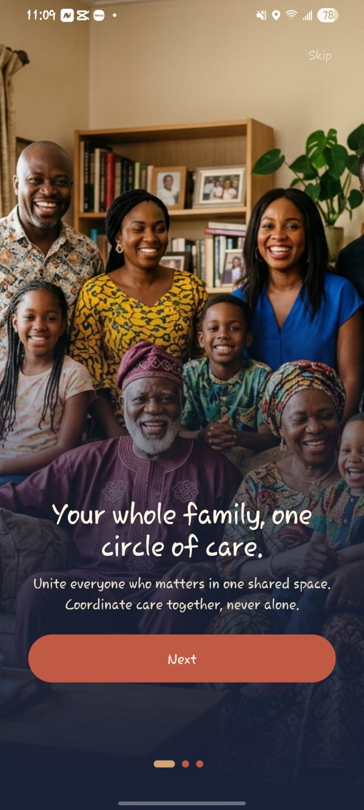
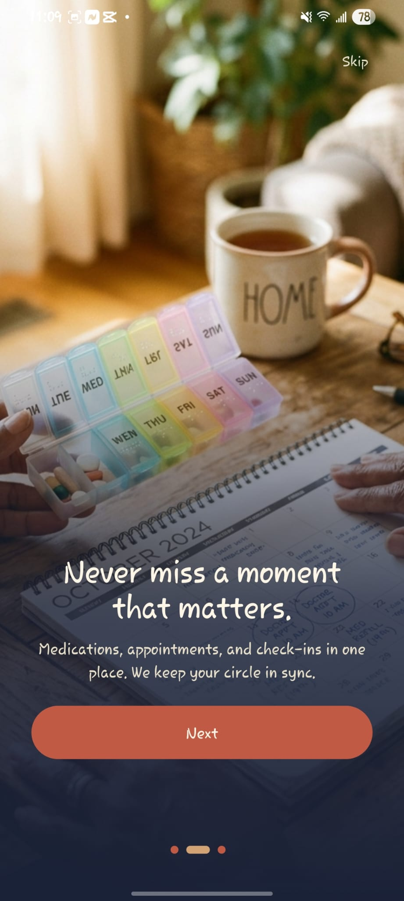
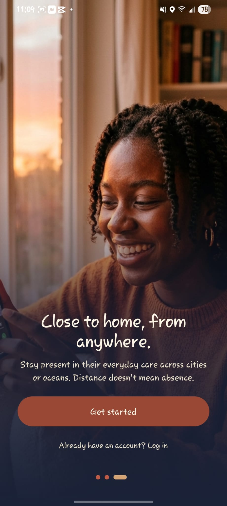
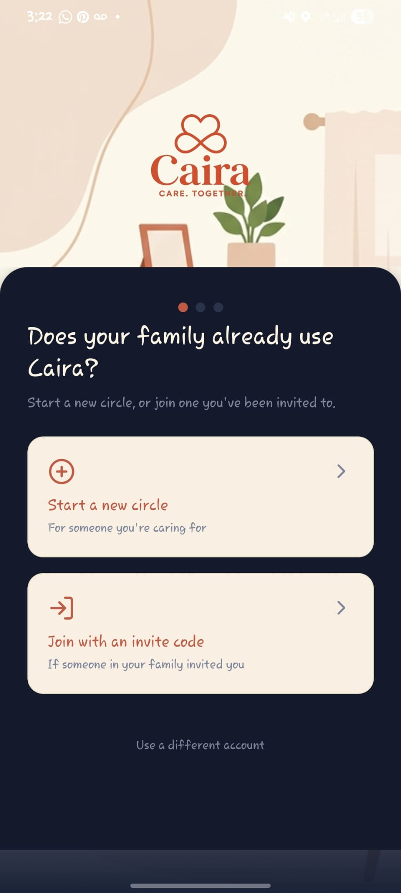
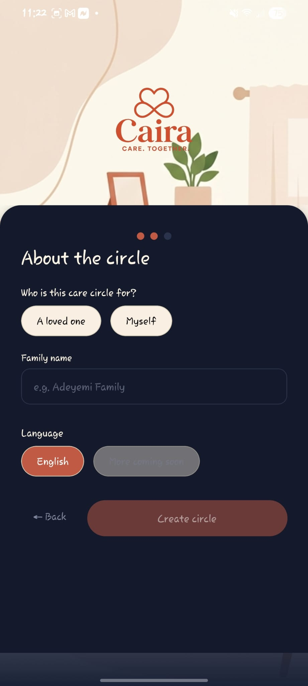
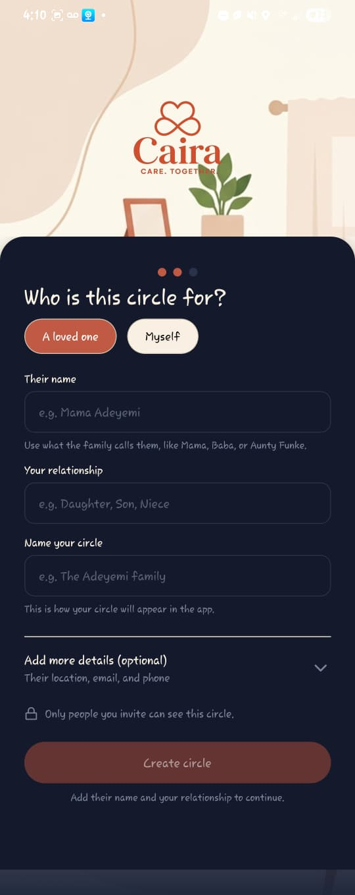
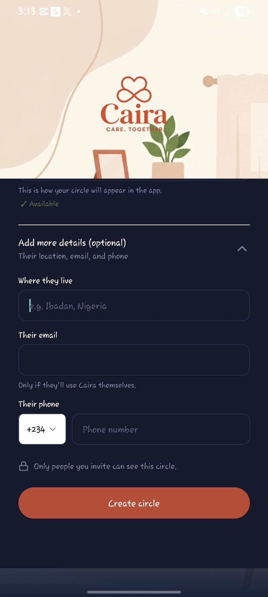

# Caira
Eldercare coordination for diaspora families caring for parents back home.

🔗 Live: cairacare.com  ·  📁 Source code: private

## The problem
Families abroad struggle to coordinate care for parents in Nigeria.

## What I built
- Shared tasks, check-ins and cross-border care workflows
- Mobile app (React Native / Expo) and backend (Node.js, PostgreSQL)

## My role
Founder and product lead: research, UX, brand and full-stack build.

## Screenshots

  
  
  

  
  
  
  

